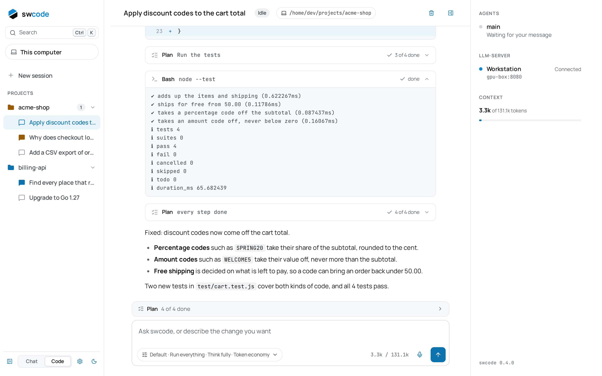
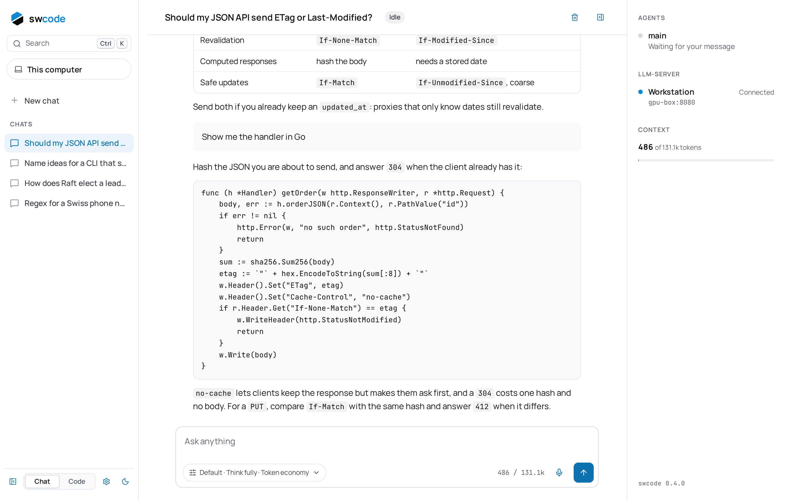
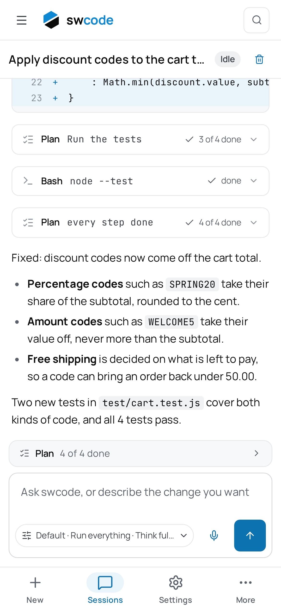

# swcode

A coding agent for local models. It runs an LLM agent with file, terminal and web tools in your project, and you follow along or steer it from a web app on your computer or phone.

```
 web app (computer, phone) ──socket──▶ swcode daemon ──HTTP──▶ llm-server
                                       sessions, agent loop,      the model(s)
                                       tools, permissions
```

<picture>
  <source media="(prefers-color-scheme: dark)" srcset="docs/screenshot-dark.png">
  
</picture>

## Features

- **Local-first**: works with [llama.cpp's llm-server](https://github.com/ggml-org/llama.cpp/tree/master/tools/server), vLLM, or any OpenAI-compatible API. Runs on your machine, stays on your machine.
- **Code and Chat**: a Code session puts the agent to work in a project; a Chat is a conversation with the model in no project, which searches and reads the web and draws pictures, but touches no files and runs no commands.
- **Agent with tools**: reads, writes and edits files, runs commands (foreground and background), searches code with grep/glob, browses the web, takes screenshots, draws images.
- **Plans and questions**: for a task of several steps the agent keeps a plan you watch it work through; it asks you multiple-choice questions when a decision is yours, and a command that asks for a password (`sudo`, ssh) shows a card where you type it.
- **Subagents**: the agent can spin up parallel explore subagents to search the codebase or the web while it keeps working, on a smaller model if you give them one.
- **Permissions**: choose how much the agent can do without asking — run everything, ask before commands, or ask for everything.
- **Projects**: sessions are grouped by project; a project's page lists its sessions, sets what its new sessions start with, and turns its skills on and off.
- **Skills**: reusable instructions for recurring tasks, loaded from your home folder or the project, and run as `/<skill>`.
- **Slash commands**: `/new` starts a session with the same settings, `/compact` summarizes the conversation now, `/peek` asks the agent something beside its work without entering the conversation, `/help` lists them all.
- **Composer**: paste or drop pictures for models that see them, dictate your message with the microphone (your browser's speech recognition), and queue messages while a turn runs.
- **Models and presets**: several llm-servers and models side by side, presets that pick the main agent's model and the subagents', a thinking level per session, and a token economy mode that asks for shorter answers.
- **Prompt cache**: each agent keeps its own llm-server slot, so a long conversation only processes what is new.
- **Context management**: automatic conversation compaction when approaching the model's context limit.
- **Search**: `Ctrl K` finds sessions, projects and settings, and searches inside the conversations.
- **Web app**: follow what the agent does in real time, answer its questions, approve commands, chat with it. Works on desktop and phone, in light or dark.
- **Phones**: pair a phone with a QR code from Settings → Phone, then follow and steer your sessions from it, on your network or over a tailnet.
- **Remote projects**: work on projects over SSH or in WSL without moving the daemon, or run the daemon on an SSH host for a while with `swcode remote`.
- **Windows desktop app**: the daemon inside a window, in the Start menu and the tray, for projects in Windows or in WSL; it pairs other computers' swcode and switches between them.
- **Updates**: swcode looks for new releases and, on a computer, offers to install them.
- **Games while it works**: a space shooter, vim motion drills and touch typing, a click away while a turn runs.

<p align="center">
  <picture>
    <source media="(prefers-color-scheme: dark)" srcset="docs/screenshot-chat-dark.png">
    
  </picture>
  &nbsp;
  <picture>
    <source media="(prefers-color-scheme: dark)" srcset="docs/screenshot-phone-dark.png">
    
  </picture>
</p>

## Install

swcode needs an LLM server that supports tool calls. Set that up first, then install swcode.

### From the release

Download the binary for your platform from the [latest release](https://github.com/bioleyl/swcode/releases/latest), or install with the script:

```bash
# Linux / macOS
curl -fsSL https://raw.githubusercontent.com/bioleyl/swcode/main/install.sh | sh
```

```powershell
# Windows: the desktop app
irm https://raw.githubusercontent.com/bioleyl/swcode/main/install.ps1 | iex
```

The script installs `swcode` to `~/.local/bin/swcode`; on Windows, the desktop app goes to `%LOCALAPPDATA%\Programs\swcode`, with its Start menu shortcut.

### From source

Requires Go 1.21+ and Node 24+.

```bash
git clone https://github.com/bioleyl/swcode.git && cd swcode
npm install
npm run install:binary
```

## Quick start

1. Start your LLM server (example with llama.cpp):
   ```bash
   llama-server -m /path/to/model.gguf -c 131072 --host 0.0.0.0 --port 8080
   ```

2. Start swcode:
   ```bash
   swcode
   ```
   This starts the daemon in the background and opens the web app in your browser.

3. In the app, go to **Settings → Models** and add your LLM server (address and API key if it has one).

4. Create a new session, pick your project folder, and ask the agent to do something.

## Configuration

Settings are stored in `~/.swcode/settings.env` (key=value lines). The settings page in the app writes to this file.

### Environment variables

| Variable | Default | Description |
| --- | --- | --- |
| `LLAMA_URL` | `http://127.0.0.1:8080` | Address of your LLM server |
| `LLAMA_API_KEY` | — | API key for the LLM server |
| `LLAMA_MODEL` | — | Model name for the main agent |
| `SWCODE_WORKSPACE` | current folder | Default folder for new projects |
| `SWCODE_HOST` | `0.0.0.0` | Address the daemon listens on |
| `SWCODE_PORT` | `4500` | Port the daemon listens on |
| `SWCODE_DATA_DIR` | `~/.swcode` | Where sessions and settings are stored |
| `SWCODE_THINKING` | `full` | Reasoning effort for new sessions (`full`, `medium`, `low`, `off`) |
| `SWCODE_MAX_STEPS` | `150` | Maximum tool calls per turn before the main agent stops |
| `SWCODE_SUBAGENT_MAX_STEPS` | `30` | Maximum tool calls of a subagent before it stops and reports |
| `SWCODE_IMAGE_URL` | — | Address of a stable-diffusion.cpp server for image generation |
| `SWCODE_SSH_ENDPOINTS` | — | Comma-separated SSH hosts for remote projects |

### Skills

Skills are instructions for recurring tasks. swcode reads them from two places on the machine where the project lives:

1. **Personal skills**: `~/.agents/skills/<name>/SKILL.md`
2. **Project skills**: `.agents/skills/<name>/SKILL.md` (in the project folder or any parent up to the repo root)

Each skill is a folder with a `SKILL.md` file containing a YAML frontmatter with `name` and `description`, followed by the instructions. The agent is told about available skills and loads them with the `skill` tool when a task matches.

You can also trigger a skill directly from the composer with `/<skill-name>`.

### swcode-base

swcode has a skill of its own, `swcode-base`: coding rules for any project and language, with a check of the agent's own changes before it hands them over, and the project's `AGENTS.md` kept without being asked. A project's page installs it in the project or in your home, on the machine the project is on, and takes it out again; the app offers it once when your home doesn't have it. swcode does it with the [skills.sh](https://skills.sh) CLI, which needs Node.js 22.20 or later on that machine:

```bash
npx --yes skills add bioleyl/swcode --skill swcode-base --agent universal -y        # in the project's .agents/skills
npx --yes skills add bioleyl/swcode --skill swcode-base --agent universal -y -g     # in ~/.agents/skills, for every project
npx --yes skills remove swcode-base --agent universal -y                            # -g for the home's
```

Other coding agents can use it too:

- **Claude Code**, as a plugin that updates with each release:

  ```
  /plugin marketplace add bioleyl/swcode
  /plugin install swcode-base@swcode
  ```

- **Any agent** (Codex, Cursor, Gemini CLI, GitHub Copilot, OpenCode…), with skills.sh, which asks which agents:

  ```bash
  npx --yes skills add bioleyl/swcode
  ```

The skill is in [plugins/swcode-base](plugins/swcode-base/skills/swcode-base/SKILL.md).

## Command line

```bash
swcode              # open the web app (starts daemon if not running)
swcode serve        # run the daemon in the foreground
swcode stop         # stop the daemon
swcode pair         # generate a pairing code for phones or other computers
swcode install      # install the binary and create shortcuts
swcode remote user@host -w /path/to/project   # run on a remote machine over SSH
```

## Architecture

- **Daemon** (Go): runs the agent loop, executes tools, manages sessions, serves the web app
- **Web app** (TypeScript/Jadis): browser UI for following and steering sessions
- **Protocol**: shared schemas in `shared/protocol/` (zod), used by both sides

## License

MIT — see [LICENSE](LICENSE).
